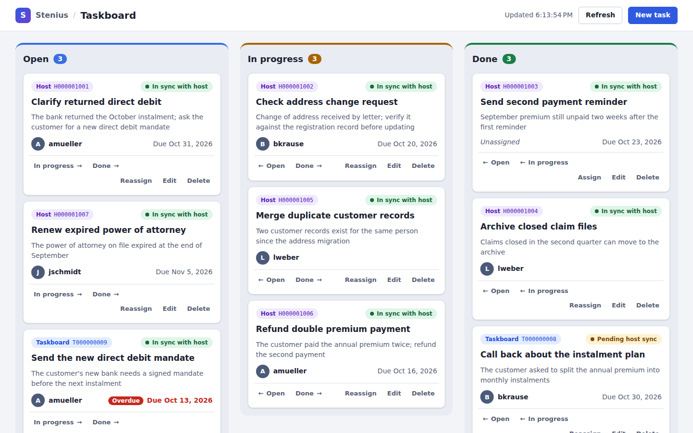
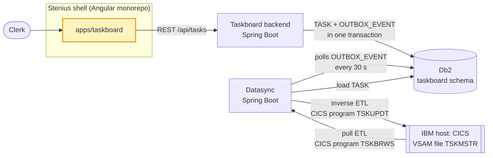
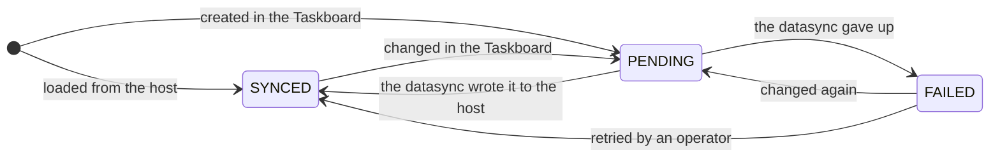
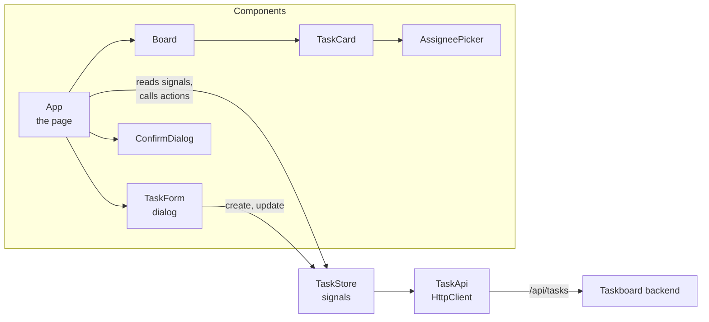

# Stenius shell: the Taskboard frontend

The Stenius shell is the Angular monorepo that holds the platform's browser apps. Its one real app, the Taskboard (`apps/taskboard`), is where clerks create, edit, assign, complete and delete tasks: it talks to the Taskboard backend's REST API and shows, for every task, whether the IBM host, which stays the back office's system of record, has caught up with it. Bridge and Console are placeholder apps.





The highlighted node is this repository. The backend owns the tasks and writes an outbox event for every change; the datasync carries those changes to the host and loads the host's tasks into the database, so the two sides are eventually consistent.

## Features

- A board with the columns Open, In progress and Done, each with its number of tasks.
- Cards with title, description excerpt, assignee, due date (overdue ones highlighted), a source badge (Host or Taskboard, with the host key when known) and a sync badge, both with an explanatory tooltip.
- A create and edit dialog that checks the host's field limits and shows the backend's validation errors on their fields.
- Quick actions: move a task to another column, assign it (suggesting the assignees already on the board) or unassign it, delete it after a confirmation.
- A refresh every 10 seconds and on demand, so that tasks loaded from the host and sync status changes appear without a reload; a banner while the backend is unreachable; an empty state.
- Plain SCSS, keyboard and screen reader friendly, and larger type on big screens.
- Two placeholder apps, Bridge and Console, that build and show one page.

## Quickstart

You need Node.js 22 (22.22.3 or later), 24 (24.15 or later) or 26 and later, the versions Angular 22 supports, with npm. Nothing else: the unit tests run in jsdom, not in a browser.

```sh
npm ci          # install the locked dependencies
npm test        # unit tests of all apps, once
npm run build   # production builds of all apps into dist/<app>
npm start       # the Taskboard on http://localhost:4200
```

`npm start` forwards the app's `/api` requests to the Taskboard backend on http://localhost:8080. Without a backend the board shows its "unreachable" banner; to use another backend, for example a stub, set `TASKBOARD_API_URL`:

```sh
TASKBOARD_API_URL=http://localhost:18080 npm start
```

npm 12 reports that the install scripts of `@parcel/watcher`, `esbuild`, `lmdb` and `msgpackr-extract` were blocked. Nothing here needs them (their prebuilt binaries come as optional dependencies), so leave them blocked.

## Configuration

| Property | Environment variable | Default | Meaning |
|---|---|---|---|
| Target of the dev server's `/api` proxy (`apps/taskboard/proxy.conf.mjs`) | `TASKBOARD_API_URL` | `http://localhost:8080` | The backend `npm start` forwards the Taskboard's API requests to. |
| API base path (`TASKS_URL` in `apps/taskboard/src/app/tasks/task-api.ts`) | none | `/api/tasks` | The app calls the backend on its own origin: through the proxy in development, through the reverse proxy that serves both in production. |
| Refresh interval (`REFRESH_INTERVAL_MS` in `apps/taskboard/src/app/app.ts`) | none | 10 seconds | How often the board reloads all tasks. |
| Dev server ports (`<app>.architect.serve.options.port` in `angular.json`) | none | 4200, 4201, 4202 | Taskboard, Bridge and Console. |

`proxy.conf.mjs` is a JavaScript proxy configuration, so it reads `TASKBOARD_API_URL` when the dev server starts; restart `npm start` after changing it. The proxy exists only in development: `npm run build` produces static files, and whatever serves them in production also routes `/api` to the backend.

## The Stenius shell

The shell is an Angular CLI workspace named `stenius` whose `apps/` folder holds the platform's apps. Each app is an independent Angular application with its own build, dev server, unit tests and lint target; they share the workspace's dependencies, TypeScript, ESLint, Prettier and Vitest settings, and nothing at runtime (no module federation, no shared router).

| App | Folder | Dev server | What it is |
|---|---|---|---|
| Taskboard | `apps/taskboard` | http://localhost:4200 (`npm start`) | The Taskboard UI, described below |
| Bridge | `apps/bridge` | http://localhost:4201 (`npm run start:bridge`) | Placeholder: one page, no features yet |
| Console | `apps/console` | http://localhost:4202 (`npm run start:console`) | Placeholder: one page, no features yet |

### Adding an app

1. Generate it, here as `reports`: `npx ng generate application reports --style scss --ssr=false --routing=false`. The workspace's schematic collection (angular-eslint) gives the new app its `eslint.config.js` and lint target, and it gets a Vitest test target like the others.
2. In `angular.json`, give `reports.architect.serve.options` a free port (`"port": 4203`), set `reports.architect.test.options` to `{ "runnerConfig": "vitest.config.mts" }` and add `"maxWarnings": 0` to `reports.architect.lint.options`.
3. In `package.json`, add `"start:reports": "ng serve reports"` and append `&& ng build reports` to the `build` script. `npm test` and `npm run lint` run every app by themselves.

## The Taskboard

### What a clerk does, and what it sends

The app uses the backend's REST API only. Every successful change makes the backend write one outbox event, which the datasync later carries to the host.

| Action | Request |
|---|---|
| Open the board, refresh (every 10 s and on demand) | `GET /api/tasks` |
| Create a task (it starts as Open) | `POST /api/tasks` with `title`, `description`, `assignee`, `dueDate` |
| Edit a task, or move it to another column | `PUT /api/tasks/{id}` with all editable fields; null clears one |
| Assign or unassign | `PUT /api/tasks/{id}/assignee` with `{"assignee": "amueller"}` or `{"assignee": null}` |
| Delete, after confirming | `DELETE /api/tasks/{id}` |

Changes appear once the backend has confirmed them, never optimistically. When a quick action fails, a notice says why (the `detail` of the backend's problem details) and the board reloads. When a refresh fails, a banner says the backend is unreachable while the board keeps the last known tasks; it disappears with the next successful refresh.

### Source and sync badges

Tasks come from two places, and the host stays the system of record: the datasync's pull ETL loads the host's tasks into the Taskboard, and every change made in the Taskboard reaches the host through the backend's transactional outbox, which the datasync's relay polls every 30 seconds. The two sides are therefore eventually consistent, and every card says where its task comes from and whether the host has caught up.

| Source badge | Meaning |
|---|---|
| Host H000001001 | Created on the IBM host and loaded by the datasync; the key is its TSK-ID on the host. |
| Taskboard T000000042 | Created in the Taskboard; the host has it under this key (T and the task id with 9 digits). |
| Taskboard | Created in the Taskboard; not on the host yet. |

| Sync badge | Sync status | Meaning |
|---|---|---|
| Pending host sync | `PENDING` | The latest change waits in the outbox; the datasync normally writes it to the host within 30 seconds. |
| In sync with host | `SYNCED` | The host has the latest version: the latest outbox event was processed, or the task came from the host and has not changed since. |
| Host inconsistency | `FAILED` | The datasync gave up on the latest change, so the host keeps an older version until an operator retries the event in the datasync. |



The backend reports a task's sync status from its latest outbox event; the board picks up every change of it with its next refresh.

### Field limits

The form checks the limits of the host's task record (copybook TSKREC) before it sends anything, and shows the backend's validation errors, the `errors` map of its `application/problem+json` answer, on the fields they are about. An error about anything else appears at the top of the dialog.

| Field | Rule | Host field |
|---|---|---|
| Title | Required, 1 to 40 characters, not only spaces | `TSK-TITLE PIC X(40)` |
| Description | Optional, up to 200 characters | `TSK-DESC PIC X(200)` |
| Assignee | Optional, a lower-case user id: `^[a-z][a-z0-9]{0,7}$` | `TSK-USER PIC X(8)`, upper case on the host |
| Due date | Optional date | `TSK-DUE-DATE PIC 9(8)`, `00000000` for none |

### Architecture



- `tasks/task.ts` is the contract's model: `Task`, the request bodies `NewTask` and `TaskUpdate`, the statuses and the field limits.
- `tasks/task-api.ts`, `TaskApi`, is the typed API client: one `HttpClient` method per endpoint. Errors are `HttpErrorResponse`s whose body is the backend's problem details (`tasks/problem-details.ts`).
- `tasks/task-store.ts`, `TaskStore`, is a small signal-based store: the tasks, whether they ever loaded, whether the backend is unreachable, the time of the last refresh and the last failed action, plus the actions that change them. It is the only place that calls `TaskApi`, applies a change once the backend has confirmed it, and drops a refresh still in flight when a change lands, so that an older answer cannot undo it.
- `app.ts`, `App`, is the page: toolbar, banners, the board and its dialogs. It refreshes on start and every 10 seconds and connects the store to the components.
- `Board`, `TaskCard`, `AssigneePicker` and `ConfirmDialog` are presentational: inputs in, outputs out. `TaskForm`, the create and edit dialog, saves through the store, because it needs the backend's answer to show its validation errors.
- All components are standalone and use OnPush change detection (Angular 22's default), signals, `input()` and `output()`, and the built-in control flow. Forms use Signal Forms (`@angular/forms/signals`), dialogs the native `<dialog>` element. The app is zoneless.
- Styles are plain SCSS: design tokens and shared building blocks (buttons, badges, tooltips, alerts, fields, dialogs) in `src/styles.scss`, layout in each component's stylesheet.

### npm scripts

| Script | What it does |
|---|---|
| `npm start` | Serves the Taskboard on http://localhost:4200 and proxies `/api` to the backend |
| `npm run start:bridge` | Serves Bridge on http://localhost:4201 |
| `npm run start:console` | Serves Console on http://localhost:4202 |
| `npm run build` | Production builds of all apps into `dist/taskboard`, `dist/bridge` and `dist/console` |
| `npm test` | Unit tests of all apps, one run without watching |
| `npm run lint` | ESLint (angular-eslint) on all apps |
| `npm run format` | Formats the workspace with Prettier |
| `npm run format:check` | Checks the formatting without changing files |

## Run the whole Taskboard system locally

You need Java 21, Node 22 or later and the three repositories cloned side by side: [harness_demo_taskboard_backend](https://github.com/Fzum/harness_demo_taskboard_backend), [harness_demo_taskboard_datasync_cics](https://github.com/Fzum/harness_demo_taskboard_datasync_cics) and [harness_demo_taskboard_frontend_stenius](https://github.com/Fzum/harness_demo_taskboard_frontend_stenius). Start them in this order, each in its own terminal:

| # | Process | Repository | Command | Ready when |
|---|---|---|---|---|
| 1 | Backend and the shared database | harness_demo_taskboard_backend | `./mvnw spring-boot:run` | http://localhost:8080/actuator/health is UP |
| 2 | CICS host simulator | harness_demo_taskboard_datasync_cics | `./mvnw -pl cics-host-simulator spring-boot:run` | http://localhost:8090/actuator/health is UP |
| 3 | Datasync | harness_demo_taskboard_datasync_cics | `./mvnw -pl datasync spring-boot:run` | http://localhost:8081/actuator/health is UP |
| 4 | Taskboard UI | harness_demo_taskboard_frontend_stenius | `npm ci && npm start` | http://localhost:4200 loads |

Try it:

1. Open http://localhost:4200. The host's tasks appear after the datasync's first ETL run (at start-up, then every 60 s; `curl -X POST http://localhost:8081/api/sync/etl/run` runs it at once).
2. Create a task. It shows "Pending host sync" until the outbox relay has written it to the host, at most 30 s later, then "In sync with host". `curl http://localhost:8090/admin/tskmstr` shows the host's records.
3. Simulate a host outage with `curl -X POST http://localhost:8090/admin/outage -H 'Content-Type: application/json' -d '{"down":true}'` and change a task: after five failed relay attempts (about 2.5 minutes) it shows "Host inconsistency", and `curl http://localhost:8081/api/sync/inconsistencies` lists the event. End the outage with `-d '{"down":false}'` and retry it with `curl -X POST http://localhost:8081/api/sync/inconsistencies/<eventId>/retry`.

## Project structure

```text
.
├── angular.json             the workspace: one project per app, with ports, proxy and test setup
├── package.json             npm scripts for all apps
├── tsconfig.json            strict TypeScript settings shared by the apps
├── eslint.config.js         shared ESLint rules; each app's eslint.config.js extends them
├── vitest.config.mts        shared Vitest settings for ng test
└── apps/
    ├── taskboard/
    │   ├── proxy.conf.mjs   dev server proxy: /api to TASKBOARD_API_URL
    │   └── src/
    │       ├── styles.scss  design tokens and the shared building blocks
    │       ├── app/
    │       │   ├── app.ts            the page; refreshes every 10 s
    │       │   ├── tasks/            model, API client, store, problem details
    │       │   ├── board/            columns with counts, empty state
    │       │   ├── task-card/        a task with its badges and quick actions
    │       │   ├── assignee-picker/  the assign quick action
    │       │   ├── task-form/        the create and edit dialog
    │       │   └── confirm-dialog/   the delete confirmation
    │       └── testing/     fixtures, DOM helpers, the jsdom stand-in for <dialog>
    ├── bridge/              placeholder app
    └── console/             placeholder app
```

## Testing

`npm test` runs the unit tests of every app once: the Taskboard's, and one trivial test per placeholder app. They run with Vitest in jsdom through the Angular CLI (`ng test`) and need neither a backend nor a browser:

- `tasks/task-api.spec.ts`: every request of `TaskApi`, its method, URL and body, exactly as in the contract, against Angular's `HttpTestingController`; error responses keep their problem details.
- `tasks/task-store.spec.ts`: refreshing, the unreachable state and its recovery, the assignee suggestions, every action and its request, dropping a refresh that a change has overtaken, and the message of a failed action.
- `board/board.spec.ts`, `task-card/task-card.spec.ts`: columns and counts, the empty state, the badges and their tooltips, overdue highlighting, the actions the components emit, including the assignee picker, and where the keyboard focus goes when a card closes its picker or changes columns.
- `task-form/task-form.spec.ts`: the field limits and the focus on the first field to correct, trimmed and nulled values, the bodies of create and edit, and the backend's validation errors on their fields.
- `app.spec.ts`: the page with its real store: loading, the refresh every 10 seconds (fake timers) and on demand, the banner, and creating, editing, moving, assigning and deleting a task through the API.

Specs sit next to the code they test; test data comes from `apps/taskboard/src/testing/tasks.ts`. jsdom has `<dialog>` elements but not their methods, so `testing/dialog-polyfill.ts` (a setup file in `angular.json`) adds `showModal()` and `close()`.

Run one app, one file or the tests whose name matches a pattern:

```sh
npx ng test taskboard --watch=false
npx ng test taskboard --watch=false --include='**/task-card.spec.ts'
npx ng test taskboard --watch=false --filter='sync status'
```

In a terminal, `ng test` without `--watch=false` keeps watching and reruns the tests on every change.

## Conventions

- `npm run lint` fails on any error or warning (`maxWarnings: 0`). It applies the recommended rules of ESLint, typescript-eslint and angular-eslint, including angular-eslint's accessibility rules for templates.
- `npm run format` formats everything with Prettier (100 columns, single quotes), `npm run format:check` only checks; `.editorconfig` holds the editor settings. `README.md` is left out of Prettier because its section "Run the whole Taskboard system locally" has to stay identical in all three repositories.
- Angular as the CLI generates it today: standalone components, OnPush, signals, `inject()`, the built-in control flow, and file names after the 2025 style guide (`task-card.ts` holds `TaskCard`).
- Commit messages follow [Conventional Commits](https://www.conventionalcommits.org/), with the app as the scope where there is one, for example `feat(taskboard): filter the board by assignee`, `fix(bridge): show the page title in the browser tab`, `build: update Angular to 22.3` or `docs: explain the sync badges`.

## About this repository

This repository is a small model of a real system, built to demonstrate the Dark Factory, a workflow that implements tickets across several repositories unattended. Names, data and scale are simplified: the Stenius shell has one real app, and the backend, the datasync and the host it talks to are models as well.
